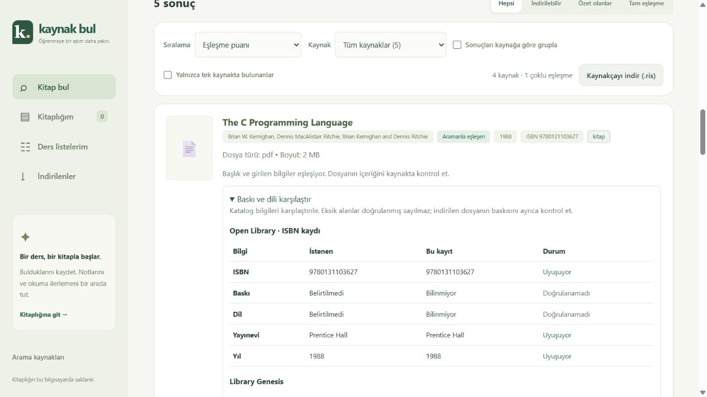
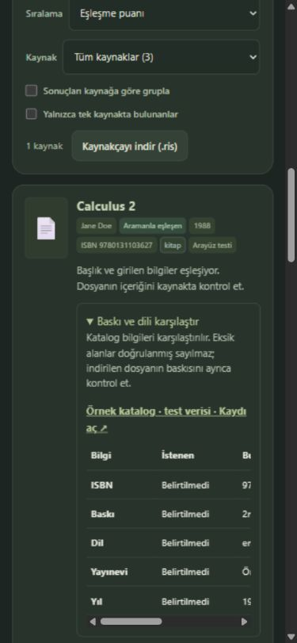

# Arama, baskı karşılaştırması ve indirme yöneticisi

21 Ekim 2026. Kullanıcının seçtiği 1, 2 ve 3 numaralı geliştirmeler uygulandı.
Bu rapor hazırlanırken commit veya push yapılmamıştı. İptal edilen Telegram çalışmasının raporu değiştirilmedi.

## 1. Daha doğru arama

- Sonuçlarda eşleşen, yakın ve diğer kayıt ayrımı; açıklamalı etiketler ve gerçek eşleşme filtresi.
- Cilt numarası, Roma rakamı, C/C++/C#, farklı yazar ve eser türü çelişkileri korunuyor.
- Yazar girilmediyse başlık puanı gereksiz yere düşmüyor. Yazar bilgisi eksikse doğrulanmış yazar eşleşmesi sayılmıyor.
- Open Library kesin aramada boş dönerse tek, en fazla beş kayıtlık yakın yazım sorgusu. Ağ hatası boş sonuç sayılmıyor.
- “Bunu mu aradın?” yalnızca gerçek sonuç başlıklarından; sayı/yazar çelişkisiyle öneri üretilmiyor. Kullanıcı seçmeden sorgu değişmiyor.
- Kaynaklara ulaşılamaması ile gerçekten boş sonuç ayrılıyor. Eski gruplama önbelleği yeniden kullanılmıyor.

## 2. Baskı ve dil karşılaştırması

Arama seçeneklerine ISBN, baskı, dil ve yayınevi tercihleri eklendi. Kartta kaynak bazında
istenen ve bulunan ISBN, baskı, dil, yayınevi ve yıl karşılaştırılıyor. Uyuşan, farklı ve
doğrulanamayan alanlar ayrı gösteriliyor. Karşılaştırmadan ilgili kaydı açmak mümkün.
Kaydedilmiş aramalar tercihleri; kitaplık ve yedekler baskı/dil bilgisini koruyor.

Bilinen ISBN/baskı/dil/yıl çelişkileri farklı kitap kartlarında kalıyor. Eksik kayıtlar
iki farklı baskıyı birbirine bağlamıyor. Tek kayıtta doğrulanmayan kısmi bilgiler farklı
kaynaklardan toplanıp doğrulanmış baskı gibi sunulmuyor.

Open Library eser aramasının toplu ISBN/dil/yayınevi dizileri belirli bir baskının
bilgisi olarak kullanılmıyor. ISBN tercihi doğrudan ilgili katalog kaydını getiriyor.
Internet Archive kayıtlarında zaten alınan metadatadan künye zenginleştiriliyor.
Bu yaklaşım [Open Library'nin eser/baskı ayrımına](https://openlibrary.org/dev/docs/api/search#editions) dayanıyor.
Karşılaştırma katalog düzeyindedir; PDF'nin içindeki baskıyı ayrıca kontrol etmek gerekir.

## 3. İndirme yöneticisi

- Arama ve kitaplıktan ortak kuyruk; iki eşzamanlı iş, toplam en fazla 20 etkin/bekleyen iş.
- Sırada, bağlanıyor, indiriliyor, doğrulanıyor, hazır, başarısız ve iptal durumları.
- Alınan baytlar; kaynak bildirirse toplam boyut ve ilerleme çubuğu. Bilinmeyen boyuta yüzde uydurulmuyor.
- Çalışan/sıradaki işi iptal, yarım dosyayı temizleme, başarısız/iptal edilen işi baştan tekrar deneme.
- Aynı etkin URL tekrar kuyruğa alınmıyor. SHA-256 kontrolü eşzamanlı biten aynı içerik için de tek sunucu dosyası tutuyor.
- Bu sayfada aynı dosyanın ikinci otomatik tarayıcı indirmesi engelleniyor; manuel bağlantı korunuyor.
- Sayfa yenilenince geçmiş işler otomatik tekrar indirilmez. Bağlantı sorunu görünür ve yeniden denenir.
- SSRF, yönlendirme, boyut, dosya imzası ve güvenli dosya sunma kontrolleri korunuyor. Eski `/api/download` uyumlu kalıyor.

Kuyruk sunucu belleğindedir ve yeniden başlatmada sıfırlanır; tamamlanan dosyalar kalır.
Duraklatma, kaldığı bayttan devam, hesaplar arası senkronizasyon ve tarayıcının indirme
geçmişini denetleme bu sürümde yoktur. Eski yinelenen dosyalar silinmez.

## Doğrulama

| Kontrol                          | Sonuç                                                                                                              |
| -------------------------------- | ------------------------------------------------------------------------------------------------------------------ |
| `npm run lint`                   | Geçti                                                                                                              |
| `npm run typecheck`              | Geçti                                                                                                              |
| `npm run test -- --maxWorkers=1` | 28 dosya, 338 test geçti                                                                                           |
| `npm run format:check`           | Geçti                                                                                                              |
| `npm run smoke`                  | Geçti; gerçek HTTP ve geçici veri dizinleri                                                                        |
| Gerçek ISBN servisi              | 9780131103627: The C Programming Language, 1988, Prentice Hall                                                     |
| Gerçek arXiv indirmesi           | 2.215.244 bayt; mevcut aynı dosya kullanıldı, uygulamada dosya sayısı artmadı                                      |
| Dosya HTTP yanıtı                | 200, `application/pdf`, attachment, `%PDF-1.5`, SHA-256 eşit                                                       |
| Kontrollü tarayıcı               | Yazım önerisi, ayrı baskılar, iki akış + bekleyen üçüncü iş, ilerleme, 503 hatası, tekrar deneme ve iptal gözlendi |
| Kontrollü yinelenen içerik       | İki tamamlanan iş, tek 2 MB dosya; yarım dosya yok                                                                 |
| 390 px koyu görünüm              | Sayfa taşmıyor; 480 px tablo kendi içinde kaydırılıyor                                                             |

Gerçek PDF SHA-256: `bdfaa68d8984f0dc02beaca527b76f207d99b666d31d1da728ee0728182df697`.
Kontrollü tarayıcı indirmesinin bilgisayara kaydı gözlendi. Gerçek arXiv PDF'sinde
tarayıcı indirme olayını bekleyen otomasyon zaman aşımına uğradı; bu son adım kesin
doğrulanmış sayılmıyor. Gerçek dosyanın sunucuya indirilmesi ve eksiksiz HTTP attachment
olarak sunulması ayrı olarak doğrulandı. Kaynakların 403/429/erişim kısıtları sürmeye devam edebilir.

Sandbox içindeki ilk çalışmada geçici modül `ENOENT` ve dosya yeniden adlandırma `EPERM`
hataları görüldü. Kod bu kısıtları aşmak için değiştirilmedi; nihai kontroller normal
Windows ortamında yapıldı. Özel kitaplık/not dosyaları ve mevcut indirmeler değiştirilmedi.

Makine tarafından okunabilir sonuç: [FEATURES-2026-10-21.json](FEATURES-2026-10-21.json).
Tekrarlanabilir, dış ağa kapalı arayüz testi: `node --import tsx reports/features-preview.mjs`
(3320 portu; açık test etiketi ve geçici veri). Bu testteki PDF bayt akışı gerçek kitap değildir.
Asıl uygulama `http://127.0.0.1:3000` adresindedir.

